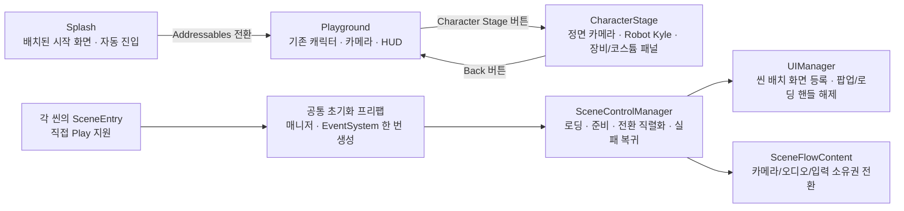

# 씬 전환과 UI 관리

- 시작 흐름은 `Splash → Playground ↔ CharacterStage`입니다. 각 씬을 직접 열어 Play할 수도 있습니다.
- 화면은 씬에 배치된 Canvas·RectTransform·Text·Button 프리팹 인스턴스입니다. 배치와 Button.onClick은 Inspector에서 편집합니다.
- `SceneEntry`가 Addressable 공통 초기화 프리팹을 준비합니다. 루트·매니저·EventSystem은 한 번만 생성하고 재사용합니다.
- `UIManager.RegisterSceneView`는 배치된 기본 화면을 재생성하지 않습니다. 로딩·팝업은 Addressables 인스턴스 수명으로 관리합니다.
- `SceneFlowContent`는 전환·메뉴·모달에 맞춰 씬 카메라·AudioListener·기존 플레이어 입력을 연결합니다.

## 실행과 편집

`Assets/Scenes/Splash.unity`를 열고 Play하면 스플래시 표시 후 Playground로 이동합니다. Playground와 CharacterStage도 각각 직접 Play할 수 있습니다. `Sample Project → Scene Flow` 메뉴에서 씬 열기와 저장된 에셋의 플레이어 빌드를 실행합니다.

| 대상 | 편집 위치 |
| --- | --- |
| 시작 씬 | Assets/Scenes/Splash.unity |
| 기존 게임플레이 | Assets/Scenes/Playground.unity |
| 정면 캐릭터 스테이지 | Assets/Scenes/CharacterStage.unity |
| 기본 화면 프리팹 | Assets/AddressablesResources/Prefabs/UI/SplashScreen.prefab, PlaygroundScreen.prefab, CharacterStageScreen.prefab |
| 공통 팝업·로딩 | 같은 UI 폴더의 Popup.prefab, Loading.prefab |
| 공통 초기화 루트 | 같은 UI 폴더의 SceneUIInitializer.prefab |
| 씬·UI 식별자 | Assets/AddressablesResources/Datas/SceneCatalog.asset, UICatalog.asset |

씬 Hierarchy의 화면 프리팹을 펼쳐 문구·배치·색상과 Button.onClick을 수정합니다. 공통 디자인 변경은 Prefab Mode에서 편집합니다. UI 생성 메뉴나 런타임 레이아웃 생성 코드는 사용하지 않습니다.

Playground는 메뉴가 열린 상태로 진입합니다. RESUME PLAY로 기존 캐릭터 제어를 시작하고 Tab으로 메뉴를 다시 엽니다. CHARACTER STAGE로 이동하며 BACK TO PLAYGROUND로 복귀합니다. 스테이지의 EQUIPMENT/COSTUME 버튼은 이미 배치한 두 패널을 전환합니다. 장비 패널의 SWORD/RIFLE 선택은 실제 장비 미리보기와 Playground 장착에 반영합니다. 코스튬은 배치 패널 미리보기입니다. [공통 전투와 AI](27-developed-combat.md)를 참고합니다.

## 씬과 화면의 소유권



직접 연 첫 씬은 재로드하지 않고 등록한 뒤 첫 전환 때 네이티브 언로드합니다. 이후 씬은 Addressables Additive 로드 핸들로 정리합니다. 카메라와 AudioListener는 각 씬에 남으며 공통 루트에 중복으로 두지 않습니다.

기본 화면은 씬이 소유하고 관리자는 수명만 등록합니다. 준비 실패로 새 씬이 해제되면 UIView의 파괴 알림으로 등록도 제거합니다. 팝업·로딩은 InstantiateAsync/ReleaseInstance를 사용합니다. 메뉴와 모달은 실제 PlayerInput·플레이어 컨트롤러·마우스 카메라를 차단하며 이동 입력을 초기화합니다.

## 버튼 연결 예

PlaygroundScreen의 CharacterStageButton은 Inspector의 Button.onClick에서 같은 프리팹의 SceneFlowView.Navigate를 호출합니다. destinationSceneId는 CharacterStage입니다. Stage의 카테고리 버튼은 SelectCategory에 정수 0/1을 전달하고 Popup의 닫기는 UIView.Close를 호출합니다. 코드는 표시 데이터와 동작만 담당합니다.

## 검증 실행

SceneFlowEditorVerification.BuildAndVerify는 저장된 에셋을 빌드하고 세 씬을 각각 직접 Play합니다. VerifyExistingBuild는 기존 번들로 Editor 검사만 반복합니다. 씬이나 UI를 생성·덮어쓰지 않습니다.

```powershell
& .\Builds\SceneFlow\SceneFlow.exe -screen-fullscreen 0 -screen-width 1280 -screen-height 720 -sceneFlowVerify "검증 결과 폴더"
```

시작 씬 이름 하위에 results.json과 실제 렌더 캡처를 저장합니다. Editor 배치 검사는 캡처를 생략하고 그래픽 플레이어에서 실제 화면을 검증합니다. 검사 없이 일반 실행하면 자동 QA는 수행하지 않습니다.
