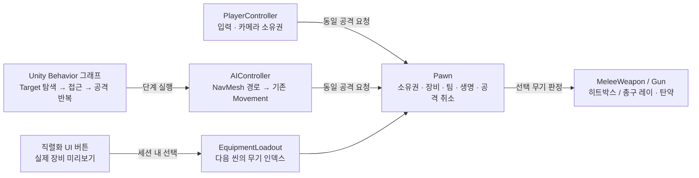

# 공통 전투와 Unity Behavior AI

- 플레이어와 AI 모두 `Pawn.TryAttack`, `SelectWeapon`, `SetWeaponDrawn`을 사용합니다. 팀·체력·메뉴 차단·공격 간격을 따로 구현하지 않습니다.
- `MeleeWeapon`은 애니메이션 이벤트의 피해 구간과 HitBox를 사용합니다. `Gun`은 총구 차폐·히트스캔·탄창·예비탄·장전을 처리합니다.
- `CombatBehavior.asset`은 실제 Unity Behavior authoring 그래프입니다. Start의 반복 아래 Find → Approach → Attack을 연결하며 Target 블랙보드를 공유합니다.
- CharacterStage의 SWORD/RIFLE 버튼은 실제 미리보기 장비와 `PlayerLoadout.asset`을 변경합니다. Playground 진입 시 같은 선택을 장착합니다. 선택은 selectionId로 구분한 현재 Play 세션에서 유지되며 번들의 에셋 인스턴스가 바뀌어도 이어집니다. PlayerLoadout은 기존 Prefabs Addressables 그룹의 명시적 공유 에셋입니다.
- 캐릭터 스테이지는 렌더 전용이므로 미리보기와 받침대 콜라이더를 비활성화합니다. 메뉴·팝업·씬 전환은 양쪽 전투를 차단합니다. 사망하면 빙의를 해제하고 메뉴를 열며 RESTART DUEL로 두 캐릭터를 복원합니다.

## 실행과 설정

Splash를 열고 Play한 뒤 RESUME PLAY를 누릅니다. 상대는 Unity Behavior로 접근·공격합니다. 주변 기존 캐릭터는 중립 훈련 더미입니다.

| 입력 | 동작 |
| --- | --- |
| WASD / Shift / Space | 이동 / 달리기 / 점프 |
| 마우스 좌클릭 | 검 공격 또는 총 발사·유지 사격 |
| 1 / 2 / Q | 검 / 총 / 다음 무기 |
| F / R | 뽑기·수납 / 총 장전 |
| Tab | 전투 메뉴 |
| F8 (Editor) | 빙의 해제·재빙의 |

| 설정 | 위치 |
| --- | --- |
| 팀·무기 목록·손/등 소켓 | RobotKyle.prefab의 Pawn |
| 피해·사거리·간격·수납 오프셋 | Weapon/TestSword.prefab, TestAK74.prefab |
| 탄창12·예비탄48·장전1.2초 | TestAK74.prefab의 Gun |
| 공통 플레이어 선택 | Datas/PlayerLoadout.asset |
| 행동 그래프 | Datas/CombatBehavior.asset (Unity Behavior로 열기) |
| 상대·NavMesh 연결 | Playground의 Behavior Opponent와 게임 모드 |
| 장비·재시작 버튼 | 기존 CharacterStageScreen/PlaygroundScreen 프리팹의 Inspector 이벤트 |

기본 피해는 무기 피해 + Pawn 공격력 - 대상 방어력입니다. 같은 팀·중립(teamId -1)·자기 자신·사망 대상은 피해를 받지 않습니다. 교체·수납·피격·메뉴 진입은 진행 중 공격과 장전을 취소합니다. 이동이 3초 동안 진행되지 않으면 AI 접근은 실패로 돌아가 그래프에서 다시 탐색합니다. 사망 복원에는 `ResetCombat`을 사용합니다.

## 재사용 구조



## 어셈블리와 검증

`Game.Runtime`은 공통 본체, `Game.Editor`는 전용 에디터입니다. `Game.Behavior`는 선택 가능한 Behavior 연결이며 본체를 참조합니다. `Game.Samples.Runtime`은 기존 SampleScene 폴더의 씬 흐름·화면·게임 모드이며 `Game.Samples.Editor`는 예제 씬 열기·빌드 메뉴입니다. `Game.Verification`과 `Game.Verification.Editor`는 명시적 검사 코드입니다. 본체는 샘플·QA·Behavior를 참조하지 않습니다. 기존 RandomDistribution 어셈블리도 유지합니다.

```powershell
& .\Builds\SceneFlow\SceneFlow.exe -screen-fullscreen 0 -screen-width 1280 -screen-height 720 -combatVerify "검증 결과 폴더"
```

검사 인자가 없으면 자동 검사는 실행하지 않습니다. 결과 JSON·실제 화면은 지정 폴더에 저장합니다. 기능별 실행 근거는 `docs/verification/combat`에 보존합니다. 검은 기존 Unsheathe/SheatheBack01_R 애니메이션 길이에 맞춰 손을 뻗는 45% 지점에서 소켓을 교체하며 완료 전 이동·공격을 차단합니다. 총은 즉시 소켓을 전환합니다. 총은 히트스캔이며 발사체·네트워크·세이브 저장·코스튬 교체는 이 예제 범위에 포함하지 않습니다.
