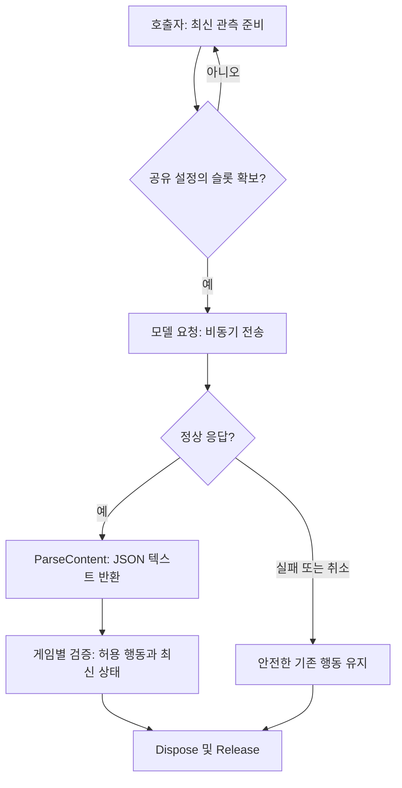

# AI 모델 통신과 호출 제한

- `Assets/Scripts/Common/AI`의 `Game.AgentModels` 어셈블리는 게임별 Pawn·행동·DDT에 의존하지 않습니다. Fantasya에서 검증한 통신과 슬롯 제한을 사용자 승인으로 공용화했습니다.
- `AgentModelSettings` 에셋에 주소·모델·동시 호출 수·시간 제한을 저장합니다. 인증키는 지정한 환경변수에서 읽으며 에셋에 저장하지 않습니다.
- 호출자는 `TryAcquire` 성공 후 `CreateRequest(settings, systemPrompt, observation)`으로 JSON 응답을 요청합니다. 성공·오류·취소 모두 요청을 Dispose하고 `Release`해야 합니다. 코루틴을 외부에서 중단할 때도 OnDisable에서 이 정리를 수행합니다.
- `ParseContent`는 응답의 JSON 텍스트만 반환합니다. 게임별 역직렬화·허용 행동·대상·응답 유효 기간 검사는 호출자 책임입니다. 이 모듈만으로 기존 AIController가 LLM 동료로 바뀌지는 않습니다.
- HTTPS 또는 루프백 HTTP만 허용하고 리디렉션은 따르지 않습니다. 로컬 Ollama는 `http://127.0.0.1:11434/v1/chat/completions`, 초기 소형 모델은 `qwen2.5:0.5b`입니다. 지원 서버는 Chat Completions와 `response_format: json_object`가 필요합니다.

## 호출과 정리 흐름



## 사용 예

MonoBehaviour의 코루틴 안에서 호출합니다. 아래 예는 입력·오류·취소·슬롯 반환을 포함한 호출 패턴이며, 외부에서 코루틴을 중단하는 경우에도 필드로 보관한 요청과 슬롯을 OnDisable에서 정리해야 합니다.

```csharp
private IEnumerator RequestDecision(AgentModelSettings settings)
{
    while (!AgentModelClient.TryAcquire(settings))
    {
        yield return null;
    }
    try
    {
        using (var request = AgentModelClient.CreateRequest(settings,
            "Return one JSON object with a permitted action.", "Allowed actions: wait, follow."))
        {
            yield return request.SendWebRequest();
            if (request.result != UnityWebRequest.Result.Success)
            {
                yield break;
            }
            string json = AgentModelClient.ParseContent(request.downloadHandler.text);
            Debug.Log(json);
        }
    }
    finally
    {
        AgentModelClient.Release(settings);
    }
}
```

예제에는 `System.Collections`, `Game.AI`, `UnityEngine`, `UnityEngine.Networking` using이 필요합니다. 예제 코루틴 자체의 씬 실행은 미확인입니다.

## 검증과 변경 기록

2026-11-11: Fantasya의 게임별 프롬프트·행동 타입을 분리하고 설정·통신·슬롯 관리만 독립 어셈블리로 반영했습니다. Unity 6000.0.83f1 참조로 새 모듈을 컴파일하고 문서를 빌드합니다. 실제 모델 연결 근거는 동일한 통신 구현을 사용하는 Fantasya의 Ollama 플레이이며, 모체의 전체 씬 실행·원격 유료 API·대규모 동시 호출은 미확인입니다. 모델 초기 로딩과 요청 왕복 시간은 별도로 측정해야 합니다.

자체 asmdef를 사용하는 호출자는 References에 Game.AgentModels를 추가합니다. 기본 Assembly-CSharp에서는 자동 참조합니다.

