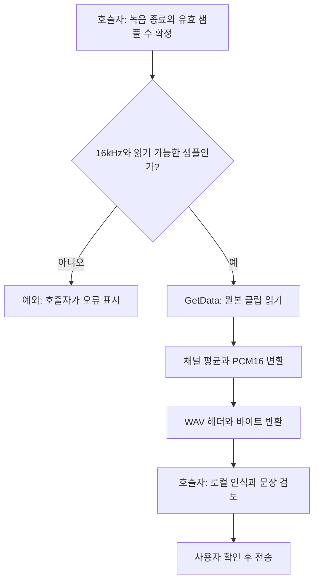

# 로컬 음성 입력용 WAV 변환

- `Assets/Scripts/Common/Audio`의 `Game.Audio`는 `UnityEngine.AudioModule`과 기본 .NET에만 의존하는 독립 어셈블리입니다. Fantasya의 실제 한국어 음성 인식 흐름에서 사용한 변환기를 사용자 승인으로 공용화했습니다.
- `AudioWaveEncoder.EncodePcm16Mono(clip, samples)`는 읽을 수 있는 **16kHz AudioClip**의 유효 샘플을 표준 RIFF/WAV PCM16 모노 바이트로 반환합니다. 여러 채널은 평균을 내고 [-1, 1]로 제한합니다. 샘플 수는 프레임 수이며 채널 수를 곱해 넘기지 않습니다.
- null·다른 주파수·범위 밖 샘플 수·읽기 실패·NaN/Infinity는 예외로 거부합니다. 샘플레이트 변환, 녹음 장치, 권한, 음성 인식, 네트워크·디스크 저장은 호출자의 책임입니다.
- 원본 클립을 수정·해제하지 않습니다. 메인 스레드에서 호출하고 녹음을 먼저 종료합니다. 녹음한 모든 프레임이 유효하다고 가정하지 말고 `Microphone.GetPosition`으로 실제 길이를 구합니다.
- 음성 인식 결과는 사용자가 확인한 후 보내도록 UI를 분리합니다. 마이크 켜기와 전송을 변환기 자체에서 수행하지 않습니다.

## 호출 흐름



## 사용 예

```csharp
/// <summary>
/// 호출자가 확정한 유효 녹음 프레임만 WAV로 변환하고 원본은 보존한다.
/// </summary>
private byte[] CreateSpeechRequest(AudioClip recording, int validSamples)
{
    return Game.Audio.AudioWaveEncoder.EncodePcm16Mono(recording, validSamples);
}
```

사용하는 자체 asmdef에 `Game.Audio` 참조를 추가합니다. 외부 입력을 전송하는 서비스는 길이·형식·크기·무음을 별도로 검사해야 합니다.

## 검증과 변경 기록

2026-11-11: Fantasya의 같은 소스를 Unity 6000.0.83f1에서 컴파일하고, 합성 한국어 4.11초 AudioClip → 공용 WAV 인코더 → 실제 로컬 Whisper → 별도 검토 입력의 흐름을 실행했습니다. 물리 마이크 녹음과 SampleProjectForUnity 전체 게임 씬은 미확인입니다. 모체에는 게임별 성격·기억·행동·UI·Whisper 실행기를 포함하지 않았습니다.
